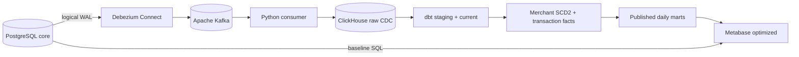

# Zibal | Payment Analytics Data Platform (T0–T5)

**Local take-home implementation.** PostgreSQL 16 → Debezium → Kafka → ClickHouse 24.8 → dbt 1.8 → Metabase. No paid/cloud services. After earlier fixes, the portable Python startup completed **one uninterrupted fresh-volume run** with the simulator enabled (`M6_START_ALL_OK`, exit 0). Demo credentials are **not** production-safe.

## Run and verify

**Prerequisites:** Python 3.9+ and Docker Engine/Desktop with Compose v2 (16 GB RAM target); no PowerShell, GNU Make or host pip packages required. From the repository root, run **one command** (Windows: `py -3`; Linux/macOS: `python3`):

```bash
python3 scripts/start.py
```

On Windows, use `py -3 scripts/start.py` (or `python scripts/start.py`). This creates `.env` from `.env.example`, seeds the source, captures CDC snapshot, builds marts, installs dashboards and finally starts the simulator.

Metabase: <http://localhost:3000> (baseline and optimized dashboards). For a quiescent test, start with `--skip-simulator`; if the simulator is running, stop it with `docker compose stop simulator` before strict verification. Run the acceptance tests once CDC is caught up:

```bash
python3 scripts/verify.py
```

On Windows, replace `python3` with `py -3`. `make up` and `make test` are optional shortcuts, not requirements. A live simulator writes continuously, but dbt transformations require the documented **single-writer pipeline cycle** (manual or external host schedule); see [operations](docs/operations-and-recovery.md).

## Source data and simulator

`core.merchants` has ≥2,000 merchants; `core.transactions` starts with **5,000,000** payments spread over the preceding 180 days across MCCs and provinces, approximately 80% SUCCESS / 10% FAILED / 10% REVERSED. Amounts and fees are **integer Iranian rials**. The simulator inserts ~20 PENDING payments/sec, later resolves them to SUCCESS/FAILED (some reversed), changes a merchant's province/risk about once per minute, and creates/deletes short-lived test payments. PostgreSQL logical replication captures both tables. Startup adds nullable `core.transactions.installments` after the initial snapshot; later, `python3 scripts/start.py --add-installments-only` repeats the ALTER idempotently.

## Architecture and choices



**Why:** PostgreSQL is the transactional source; Debezium provides snapshot/WAL CDC including deletes; **Apache Kafka** provides an established open-source Debezium/Connect integration and replayable ordered partitions. **Redpanda was considered** but offered no necessary benefit for this small, already-tested Kafka-based setup. ClickHouse was selected for columnar scans and fast aggregates over millions of payments, while keeping reporting load off PostgreSQL; measured local median query improvements are **14.66×–159.74×**. dbt makes transformations/test logic reviewable. We avoided polling/custom triggers, a second PostgreSQL reporting database, and Airflow/Spark/Lakehouse because they added implementation or runtime complexity without benefiting this bounded exercise. See [architecture/model](docs/architecture-and-data-model.md).

## Layer rules and analytical grains

| Layer / table(s) | Grain; allowed / not allowed |
|---|---|
| `core.merchants`, `core.transactions` | **Merchant ID** / **transaction ID**; operational source of truth, PII allowed only here and restricted raw |
| `raw.cdc_merchants`, `raw.cdc_transactions` | **Topic + partition + offset**; immutable before/after CDC events, *not* dashboard queries |
| `stg_*_events` (2) | **One CDC event** each; typed, masked merchant identifiers; no raw plaintext personal IDs |
| `stg_*_current` (2) | **Entity ID** (logical `FINAL`); latest state including hard-delete tombstones, not history dimensions |
| `dim_merchant_history` | **Merchant + version**; `[valid_from, valid_to)` with baseline assumption |
| `fct_transactions`, `fct_transactions_reporting` | **Transaction ID** (logical `FINAL`); reporting view reattributes province/risk at `created_at` |
| `daily_metric_rows` + `daily_metric_publications` | **Date + run + metric grouping** / **date**; publish full daily batches via revision pointer |
| `agg_daily_sales`, `agg_daily_channel`, `agg_daily_merchant`, `agg_daily_fee_mcc_province`, `agg_daily_risk` | **Date**; **date/channel**; **date/merchant**; **date/MCC/province**; **date/risk**. Published SUCCESS/terminal metrics only |

Raw CDC is **at least once**; checkpointed bounded offsets plus `ReplacingMergeTree`/`FINAL` provide logical replay safety. `Asia/Tehran` days and **Gregorian** months are used. The channel success denominator is SUCCESS+FAILED+REVERSED (PENDING excluded). See [data model](docs/architecture-and-data-model.md) and [governance](docs/ownership-and-sensitivity.md).

## Metabase results (20 runs per card/database; 1 warm-up; fixed 2026-11-13)

| Card | PostgreSQL median ms | ClickHouse median ms | Optimization |
|---|---:|---:|---|
| 1. Daily successful count/amount, 90d | 1397.74 | 25.11 | Pre-published date totals |
| 2. Channel success rate, 30d | 1098.70 | 22.73 | Published day/channel terminal counts |
| 3. Top 10 merchants, current month | 425.31 | 29.02 | Day/merchant amounts; final top-10 ranking |
| 4. Fees by MCC/province, 90d | 962.18 | 24.43 | Historical province-at-payment grouping |
| 5. Monthly success by risk | 3262.60 | 20.43 | Historical risk-at-payment grouping |

Metabase API query latency (not dashboard rendering); baseline had ordinary PostgreSQL indexes and cache was disabled/checked. Cards **1–3 match exactly**. Card 4 totals reconcile but province groups differ where merchant attributes changed; card 5 **deliberately corrects current-risk baseline attribution**. Evidence: [comparison](reports/m4b_comparison.json), [20-run timings](reports/m4b_benchmark.json), and [daily reconciliation](reports/m5b_daily_reconciliation.json) (183/183 dates, count/amount deltas zero).

## Assumptions, simplifications and unfinished work

The initial merchant snapshot does **not** reconstruct pre-CDC risk/province history; it is flagged as an assumed baseline. The demo uses one Kafka partition per table, a single pipeline writer, manual/externally scheduled dbt cycles and localhost credentials. Continuous dbt scheduling, concurrent-writer safety, HA, production secret management and Linux/macOS runtime validation are **not claimed**. Fresh-start monitoring observed **5.16 GiB peak concurrent container memory** (144 samples); total physical-host RAM use on a 16 GB machine was **not measured**. The one-command run succeeded after earlier development fixes, not before them. No enterprise Lakehouse or organization-wide governance implementation was attempted. Detailed test/recovery commands: [operations](docs/operations-and-recovery.md), [quality](docs/quality-and-governance.md), [evidence](docs/validation-and-benchmarks.md).
