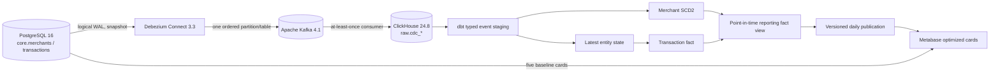
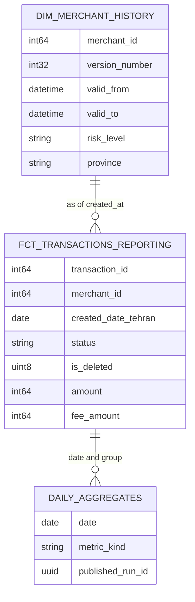

# Architecture and analytical data model

This document is the authoritative **T1–T3 design reference**. The README contains the short version required for delivery; implementation SQL and Python remain the source of truth.

## Architecture

All services run locally through Docker Compose. The four Compose files are **one composed deployment**, separated by concern: `docker-compose.yml` (source/seed/simulator/ClickHouse/Metabase), `.m2.yml` (Kafka/Connect), `.m2b.yml` (raw initializer/consumer), and `.m3a.yml` (dbt runner). The suffixes are retained to avoid breaking the validated commands; operators use `scripts/start.py` and need not invoke the overlays separately.

## Decisions and rejected alternatives

| Choice | Why it fits the exercise | Alternative considered / why not used |
|---|---|---|
| PostgreSQL 16 | Operational source, constraints, logical WAL CDC | Starting with an analytical DB would fail to model the requested OLTP baseline |
| Debezium Connect | Snapshot + inserts/updates/deletes and source metadata without hand-built CDC | Polling triggers/custom SQL would require more custom ordering, delete and snapshot logic |
| Apache Kafka (single KRaft broker) | Known open-source Connect/Debezium path; replayable topics, offset-based checkpoints | **Redpanda** was considered; no needed advantage established for this bounded, working single-broker demo. Not a measured performance comparison |
| ClickHouse | Columnar compression and aggregate speed for millions of payment rows; protects OLTP source; observed 14.66×–159.74× query improvement | PostgreSQL read replica/materialized views would still tie reporting execution to a row-store engine; no comparative benchmark was run against this alternative |
| dbt-clickhouse + small Python runners | SQL reviewability and reusable tests; bounded incremental checkpoints | Spark/Flink/Airflow/Lakehouse/Kubernetes add runtime/ops complexity; not required by PDF |
| Metabase | Same UI/API for PostgreSQL baseline and optimized reporting | Custom BI frontend adds irrelevant work |

No claims of HA, auto-scaling, cluster sharding, or production-level credentials. The PDF explicitly reserves large-scale and Lakehouse discussions for the interview.

## Layer contracts

| Layer | Permitted | Not permitted |
|---|---|---|
| `core` (PostgreSQL) | Operational writes, sensitive source fields, simulator queue (separate schema) | Dashboard-specific summary storage in transactional records |
| `raw` (ClickHouse) | Event history, before/after JSON, Kafka identity and source WAL metadata | Direct Metabase reads, business rollup assumptions |
| `staging` event models | Event identity, typed columns, deletion flag, **masked** merchant national ID/mobile | Unmasked source PII, historical merchant attribution guesses |
| `staging` current models | Logical most-recent state, delete tombstones, offset-versioned replay | Mistaking current state for history; reporting without `FINAL` |
| `marts` SCD2/fact | Merchant validity windows, transaction grain, temporal join at transaction `created_at` | Rewriting prior facts with same Kafka-offset version after merchant-only change |
| `marts` published aggregates | One complete revision per affected day; SUCCESS-only sales, terminal channel denominator | Summing CDC events (would double count reversals), showing unpublished revisions |
| Metabase | Read-only published aggregates, an authorized minimal merchant dependency | Selecting raw PII or user-managed upstream modifications |

## Grain and keys (each important persisted table or view)

| Relation | Grain / identity | Description |
|---|---|---|
| `core.merchants` | `merchant_id` | Current operational merchant attributes and source PII |
| `core.transactions` | `transaction_id` | Current operational payment and status |
| `raw.cdc_merchants`, `raw.cdc_transactions` | `(kafka_topic, kafka_partition, kafka_offset)` | Full CDC event log, at least once; read with `FINAL` |
| `staging.stg_merchants_events`, `staging.stg_transactions_events` | `(kafka_topic, kafka_partition, kafka_offset)` | Typed and incrementally consumed CDC events |
| `staging.stg_merchants_current` | `merchant_id` | Logical latest merchant row, read with `FINAL` |
| `staging.stg_transactions_current` | `transaction_id` | Logical latest transaction row and delete tombstone |
| `staging.staging_checkpoints` | `stream`, committed offset window | Bounded CDC stage-progress ledger; multiple audit rows/stream |
| `staging.current_state_checkpoints` | `stream`, committed offset window | Latest-state progress ledger; multiple audit rows/stream |
| `marts.dim_merchant_history` | `(merchant_id, version_number)` | SCD2 view; `[valid_from, valid_to)` |
| `marts.fct_transactions` | `transaction_id` (logical `FINAL`) | Current transaction fact, versioned by Kafka offset |
| `marts.fct_transactions_reporting` | `transaction_id` (view) | Re-attributes merchant MCC/province/risk using transaction creation time |
| `marts.fact_checkpoints` | transaction stream / offset window | Physical-fact progress ledger |
| `marts.daily_metric_rows` | `(date, run_id, kind, grouping)` | Append-only, unpublished/published per-day candidate metric rows |
| `marts.daily_metric_publications` | `date` (`FINAL` latest revision) | Visibility pointer: commit a date after all groups validate |
| `marts.daily_aggregate_checkpoints` | transaction/merchant offset-pair window | Aggregate publishing progress ledger |
| `marts.agg_daily_sales` | `date` | SUCCESS count and amount |
| `marts.agg_daily_channel` | `(date, channel)` | SUCCESS and terminal counts for rates |
| `marts.agg_daily_merchant` | `(date, merchant_id)` | SUCCESS count/amount; top-merchants card |
| `marts.agg_daily_fee_mcc_province` | `(date, mcc, province)` | SUCCESS fee and historical province |
| `marts.agg_daily_risk` | `(date, risk_level)` | SUCCESS count/amount by historical risk |

### Dimensional model

The join is based on `created_at` and the merchant's half-open version interval, **not** the transaction's last update time. A new merchant CDC version can reattribute old physical facts through the reporting view; the daily publisher marks impacted payment dates dirty. Merchant source `updated_at` defines the effective time and must advance for tracked attribute changes. This is a one-partition demo, so Kafka offset gives deterministic per-entity event order; LSN is kept as metadata, not claimed as a globally ordered ledger.

**Important limitation:** the initial Debezium snapshot contains only the merchant state at capture. The SCD2 view flags its artificial `1970-01-01` baseline and cannot prove pre-snapshot risk/province correctness. Merchant hard-delete handling and backdated, equal-timestamp merchant updates are outside the demonstrated model.
